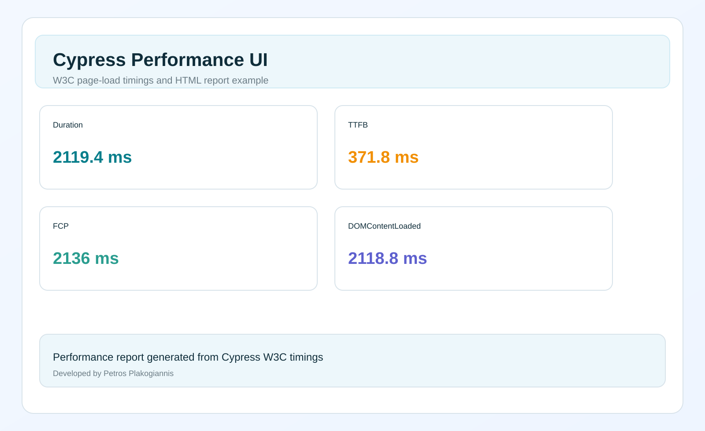
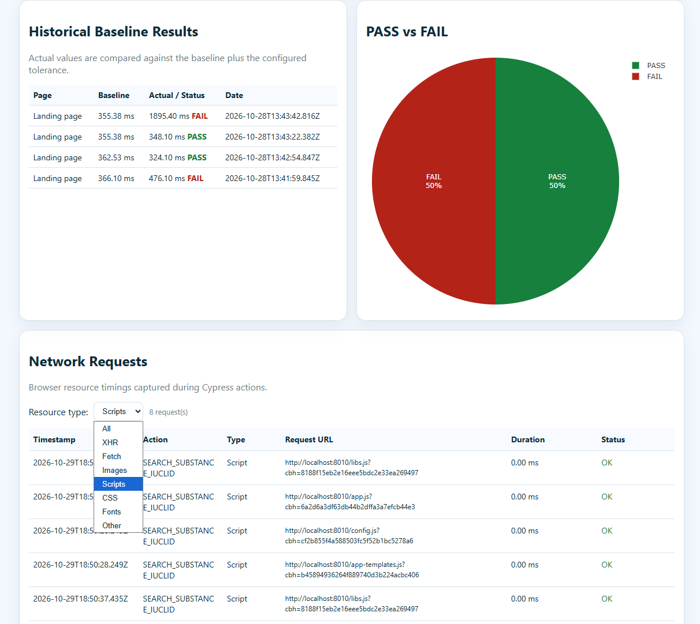
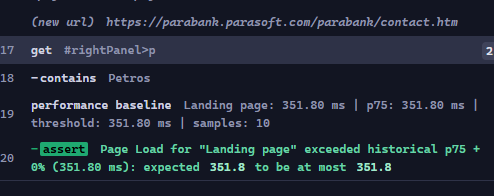
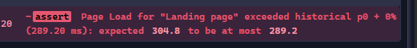

# Cypress Performance UI

Performance testing directly inside your Cypress tests.

Collect browser-native performance metrics, persist historical results, and generate visual HTML reports — no Lighthouse required.

## Features

- Browser-native performance metrics using the Performance API
- Network request timings for XHR, Fetch, Images, Scripts, CSS, Fonts, and Other
- Filterable Network Requests dashboard with duration thresholds and OK/SLOW status
- Persistent JSON performance history
- Visual HTML performance dashboard
- Performance trends across multiple test runs
- First Contentful Paint (FCP)
- Response Start / TTFB
- DOM Content Loaded
- Load Event
- Total page load duration
- Resettable performance history
- Historical page-load baseline assertions using configurable percentiles and tolerance
- Baseline PASS/FAIL history table and ratio pie chart in the HTML dashboard
- TypeScript definitions with autocomplete and type checking for Cypress commands
- No Lighthouse dependency
- Designed specifically for Cypress

## Report Preview



## Install

```bash
npm install --save-dev cypress-performance-ui
```

## Setup

Cypress Performance UI contains two parts:

- Browser-side Cypress commands for collecting performance metrics
- A Node-side plugin for managing persistent performance history

### 1. Register the Node plugin

Update your `cypress.config.js`:

```js
const { defineConfig } = require("cypress");

const {
  registerPerformancePlugin,
} = require("cypress-performance-ui/plugin");

module.exports = defineConfig({
  e2e: {
    setupNodeEvents(on, config) {
      registerPerformancePlugin(on, config);

      return config;
    },
  },
});
```

If you already have a `setupNodeEvents()` function, simply call:

```js
registerPerformancePlugin(on, config);
```

inside your existing function.

### 2. Register the Cypress commands

In:

```text
cypress/support/e2e.js
```

add:

```js
import "cypress-performance-ui";
```

or:

```js
require("cypress-performance-ui");
```

## TypeScript Support

Cypress Performance UI includes TypeScript declarations for its custom Cypress commands, including `cy.assertPageLoadBaseline()`. This enables editor autocomplete and type checking without converting the plugin itself to TypeScript.

In a TypeScript Cypress project, register the commands in `cypress/support/e2e.ts`:

```ts
import "cypress-performance-ui";
```

Keep the Node plugin registration in `cypress.config.js` or `cypress.config.ts` as described in [Setup](#setup).

Example TypeScript test:

```ts
describe("Page load performance", () => {
  it("checks the historical baseline", () => {
    cy.visit("/landing");

    cy.assertPageLoadBaseline("Landing page", {
      percentile: 75,
      historyDays: 30,
      minSamples: 10,
      tolerance: 10,
    });
  });
});
```

The `index.d.ts` declarations are shipped with the npm package. You do not need to install TypeScript just to use the plugin in an existing JavaScript Cypress project.

**Compatibility note:** TypeScript integration was tested with Cypress `15.13.0` and TypeScript `5.8.3`. These are tested versions, not minimum or required versions. If Cypress cannot compile `.cy.ts` files, ensure TypeScript is installed in the consuming project and a `tsconfig.json` exists in the project root or `cypress/` directory. If you encounter a Webpack/`ts-loader` compilation error, check the installed Cypress and TypeScript versions.

## Quick Start

Once configured, generate a performance report directly from your Cypress test:

```js
describe("Performance", () => {
  it("measures landing page performance", () => {
    cy.visit("/landing");

    cy.generatePerformanceReport(
      "cypress/performance/reports/performance-report.html",
      "Landing page"
    );
  });
});
```

That's it.

Each execution automatically:

1. Collects browser performance metrics
2. Reads the existing performance history
3. Appends the new measurement
4. Saves the results to JSON
5. Regenerates the HTML dashboard using the complete history

## Generated Files

By default, performance data is stored under:

```text
cypress/
└── performance/
    ├── results/
    │   └── performance-results.json
    │ 	└── network-results.json
    │
    └── reports/
        └── performance-report.html
```

The JSON file contains the historical measurements.

The HTML report visualizes the collected results across multiple test runs.

## Network Requests

Collect browser network resource timings (XHR, Fetch, Images, Scripts, CSS, Fonts and Other) during Cypress actions.
Clear resource timings **before** the action, wait for the API response, then collect:

```js
cy.visit("https://your-app.example");
cy.intercept("GET", "**/api/products*").as("products");
cy.clearNetworkTimings();
cy.get("#search-button").click();
cy.wait("@products");
cy.collectNetworkMetrics("Product Search", { threshold: 500 });
```

Results are appended to `cypress/performance/results/network-results.json` and
the HTML dashboard is refreshed automatically with a **Network Requests** table.
`threshold` is in milliseconds. Requests above the threshold are marked **SLOW**.

**Limitations:** This measures browser-observed request duration, not SQL execution
time. Cross-origin resources may expose limited timing information without
`Timing-Allow-Origin`. Requests completed before clearing or after collecting
are not included. Request URLs can contain sensitive query
parameters; review reports before sharing.

### Filter requests by resource type

The HTML report includes a **Network Requests** table with a **Resource type** filter (All, XHR, Fetch, Images, Scripts, CSS, Fonts, Other). URLs wrap inside the table so Duration and Status stay visible. Resource types are based on the browser Performance API `initiatorType`; some resources may appear as Other. Older saved network rows without a type are classified as Fetch/XHR when possible, otherwise Other.

### Network Requests dashboard screenshot

Filter requests by resource type to focus on API calls, images, scripts, CSS, fonts, or all resources. The table shows each request URL, duration, status, action, and timestamp. Long URLs wrap so the Duration and Status columns stay visible.



## Commands

### `cy.clearNetworkTimings()`

Clears browser resource timings before an action, so you can capture the requests triggered by that action.

```js
cy.clearNetworkTimings();
```

### `cy.collectNetworkMetrics(actionName, options)`

Collects network resource timings and saves them to the HTML dashboard. Set `threshold` in milliseconds to mark requests as **SLOW**.

```js
cy.collectNetworkMetrics("Product Search", { threshold: 500 });
```

See [Network Requests](#network-requests) for the full example, filters, and screenshot.


### `cy.collectPageLoadMetrics(pageName)`

Collects browser performance metrics from the current page using `window.performance`.

```js
cy.collectPageLoadMetrics("Landing page").then((result) => {
  console.log(result);
});
```

Example result:

```js
{
  pageName: "Landing page",
  timestamp: "2026-10-07T12:00:00.000Z",
  url: "https://example.com/landing",
  metrics: {
    duration: 1678.2,
    responseStart: 123.5,
    domContentLoaded: 786.3,
    loadEventEnd: 1498.8,
    firstContentfulPaint: 442.4,
    navigationStart: 0
  }
}
```

This command only collects and returns the metrics.

It does not persist them to disk.

---

### `cy.measureW3CTimings(pageName)`

Returns the collected browser performance values in a W3C-style timing object.

```js
cy.measureW3CTimings("Landing page").then((result) => {
  console.log(result.w3cTimings);
});
```

---

### `cy.savePerformanceMetrics(pageName, jsonPath)`

Collects the current page performance metrics and appends them to the persistent JSON history.

```js
cy.savePerformanceMetrics("Landing page");
```

Default JSON location:

```text
cypress/performance/results/performance-results.json
```

You can optionally provide a custom path:

```js
cy.savePerformanceMetrics(
  "Landing page",
  "cypress/results/my-performance-history.json"
);
```

---

### `cy.generatePerformanceReport(filePath, pageName, jsonPath)`

Collects the current performance metrics, saves them to the JSON history, and generates an HTML dashboard using all stored measurements.

```js
cy.generatePerformanceReport(
  "cypress/performance/reports/performance-report.html",
  "Landing page"
);
```

The default paths are:

```text
JSON:
cypress/performance/results/performance-results.json

HTML:
cypress/performance/reports/performance-report.html
```

A custom JSON history path can also be supplied:

```js
cy.generatePerformanceReport(
  "cypress/performance/reports/performance-report.html",
  "Landing page",
  "cypress/performance/results/custom-history.json"
);
```

For most use cases, this is the main command you need.

---

### `cy.assertPageLoadBaseline(pageName, options)`

Compares the current page-load duration against a percentile calculated from previously saved JSON performance history. The Cypress assertion passes when the current duration is less than or equal to the allowed threshold, and fails when it is higher.

First, collect historical measurements using `cy.generatePerformanceReport()` or `cy.savePerformanceMetrics()`. Then run the assertion **after `cy.visit()`**:

```js
cy.visit("/landing");

cy.assertPageLoadBaseline("Landing page", {
  percentile: 75,
  historyDays: 30,
  minSamples: 10,
  tolerance: 10,
});
```

The baseline uses the page name to select matching history entries. The threshold is calculated as:

```text
threshold = historical percentile * (1 + tolerance / 100)
```

For example, a historical p75 of `350 ms` with `10%` tolerance allows up to `385 ms`.

#### Options

| Option | Default | Description |
|---|---|---|
| `percentile` | `75` | Historical percentile (0–100), calculated with linear interpolation. |
| `historyDays` | `30` | Include measurements from the last N days. |
| `minSamples` | `10` | Minimum matching historical measurements required. |
| `tolerance` | `10` | Allowed percentage above the calculated baseline. |
| `jsonPath` | `cypress/performance/results/performance-results.json` | Path to the JSON history file. |
| `baselineResultsPath` | `cypress/performance/results/baseline-results.json` | Path to the saved baseline comparisons. |
| `reportPath` | `cypress/performance/reports/performance-report.html` | HTML dashboard updated after each comparison. |

If there are fewer than `minSamples` matching measurements, the command fails with an insufficient-history error. It does **not** automatically save the current measurement to JSON.

#### Baseline results in the HTML dashboard

Each baseline assertion saves a comparison (including **FAIL** results) to:

```text
cypress/performance/results/baseline-results.json
```

The HTML dashboard is automatically updated after each baseline assertion. It shows a **four-column table** (Page, Baseline, Actual / Status, Date) and a **PASS vs FAIL pie chart**. PASS/FAIL is determined by the tolerance-adjusted threshold, not simply by whether Actual exceeds Baseline. The dashboard also retains the existing performance charts and raw measurements.

You can override the result and report paths if needed:

```js
cy.assertPageLoadBaseline("Landing page", {
  baselineResultsPath: "cypress/performance/results/baseline-results.json",
  reportPath: "cypress/performance/reports/performance-report.html",
});
```

The HTML report can be opened after the test, including after a baseline FAIL. Results accumulate across test runs as long as the JSON files are retained. An insufficient-history error does not create a PASS/FAIL result because no comparison was possible.

#### Cypress assertion examples

**PASS:** The current page load is within the historical threshold.



**FAIL:** The current page load exceeds the threshold. This example intentionally uses `percentile: 0` and `tolerance: 0` to demonstrate a failing assertion; `p75` is recommended as a more practical starting point.



#### Recommended test workflow

```js
describe("Page load performance", () => {
  it("stays within the historical baseline", () => {
    cy.visit("/landing");

    cy.assertPageLoadBaseline("Landing page", {
      percentile: 75,
      historyDays: 30,
      minSamples: 10,
      tolerance: 10,
    });
  });
});
```

**Important:** Run the baseline assertion before saving the current navigation's metrics. If the same navigation has already been saved to history earlier in the test, that measurement can be included in the baseline. Keep historical results available between test runs; ephemeral CI workers need persisted artifacts or another shared history source. Avoid clearing history before running baseline assertions.

---

### `cy.clearPerformanceHistory(jsonPath)`

Clears the stored performance history.

```js
cy.clearPerformanceHistory();
```

This is useful when starting a new performance test cycle.

For example:

```js
describe("Performance", () => {
  before(() => {
    cy.clearPerformanceHistory();
  });

  it("measures landing page", () => {
    cy.visit("/landing");

    cy.generatePerformanceReport(
      "cypress/performance/reports/performance-report.html",
      "Landing page"
    );
  });
});
```

## Historical Performance Tracking

Every call to:

```js
cy.generatePerformanceReport(...)
```

adds a new measurement to the JSON history.

For example, after multiple test runs:

```json
[
  {
    "pageName": "Landing page",
    "timestamp": "2026-10-07T10:00:00.000Z",
    "metrics": {
      "duration": 820.4,
      "responseStart": 140.2,
      "firstContentfulPaint": 350.1
    }
  },
  {
    "pageName": "Landing page",
    "timestamp": "2026-10-07T10:05:00.000Z",
    "metrics": {
      "duration": 910.7,
      "responseStart": 152.8,
      "firstContentfulPaint": 381.4
    }
  }
]
```

The HTML dashboard uses this history to visualize performance trends over time.

## Performance Metrics

Cypress Performance UI currently collects:

| Metric | Description |
|---|---|
| `navigationStart` | Navigation entry start time |
| `responseStart` | Time until the browser starts receiving the response |
| `domContentLoaded` | Time until the DOMContentLoaded event completes |
| `loadEventEnd` | Time until the page load event completes |
| `firstContentfulPaint` | First Contentful Paint (FCP) |
| `duration` | Total navigation duration |

Metrics are reported in milliseconds.

## How It Works

```text
Cypress Test
     │
     ▼
Browser Performance API
     │
     ▼
collectPageLoadMetrics()
     │
     ▼
Persistent JSON History
     │
     ▼
generatePerformanceReport()
     │
     ▼
Visual HTML Dashboard
```

The browser-side commands collect performance data using the native browser Performance API.

Filesystem operations are handled separately through the Cypress Node plugin.

This keeps Node APIs such as `fs` out of the browser bundle.

## Why Cypress Performance UI?

Performance testing often requires introducing additional tooling into an existing test stack.

Cypress Performance UI is designed to keep basic page-load performance measurement close to your Cypress tests.

It uses browser-native performance APIs and provides persistent historical data plus a visual report without requiring Lighthouse.

## Example

```js
describe("Application performance", () => {
  before(() => {
    cy.clearPerformanceHistory();
  });

  it("measures home page", () => {
    cy.visit("/");

    cy.generatePerformanceReport(
      "cypress/performance/reports/performance-report.html",
      "Home"
    );
  });

  it("measures login page", () => {
    cy.visit("/login");

    cy.generatePerformanceReport(
      "cypress/performance/reports/performance-report.html",
      "Login"
    );
  });

  it("measures dashboard", () => {
    cy.visit("/dashboard");

    cy.generatePerformanceReport(
      "cypress/performance/reports/performance-report.html",
      "Dashboard"
    );
  });
});
```

All three measurements are stored in the same JSON history and displayed in the generated HTML dashboard.

## Requirements

- Cypress
- A browser with support for the Performance API
- Node.js

## Author

Petros Plakogiannis

## License

MIT
